# Awesome-Cloud-Data-Migration-Seeding 🚀

  
  
  
  
  
  

**Curated Catalog of Enterprise SaaS Platforms & High-Performance Open-Source GitHub Projects**  
*Focused on Cloud Data Migration, Database Seeding, Workload Transfer, Change Data Capture (CDC), and Zero-Downtime Cutovers*  
**Updated: March 2026**

---

## 📌 Table of Contents
- [🔍 SEO Overview & Keywords](#-seo-overview--keywords)
- [📊 Sector Overview & Market Dynamics](#-sector-overview--market-dynamics)
- [☁️ SaaS / Hosted Enterprise Platforms](#️-saas--hosted-enterprise-platforms)
- [⚡ Open-Source GitHub Projects](#-open-source-github-projects)
- [🛠️ Reference Architecture for Zero-Downtime Data Migration](#️-reference-architecture-for-zero-downtime-data-migration)
- [🤝 How to Contribute](#-how-to-contribute)
- [💖 Support & Sponsorship](#-support--sponsorship)
- [📈 Star History](#-star-history)
- [⚠️ Disclaimer](#️-disclaimer)

---

## 🔍 SEO Overview & Keywords
This curated ecosystem index is engineered for data architects, DevOps practitioners, site reliability engineers (SREs), data platform teams, and full-stack developers searching for:
- **Cloud Migration & Workload Portability**: Lift-and-shift server replication, cross-cloud VM cutovers, container migrations, and tenant-to-tenant Microsoft 365 migrations.
- **Database Migration & Schema Evolution**: Multi-cloud relational, NoSQL, and data warehouse schema migration, continuous change data capture (CDC), and cross-database sync (PostgreSQL, MySQL, SQLite, Oracle, SQL Server, Snowflake, BigQuery, Databricks).
- **Synthetic Data Generation & Test Seeding**: Deterministic seed datasets, realistic fake mock data generation, performance stress benchmarking, and reproducible staging environments.
- **Zero-Downtime Data Transfer**: Resumable multi-threaded chunked file sync, block-level storage replication, and journal-based disaster recovery.

---

## 📊 Sector Overview & Market Dynamics

The global cloud migration services market is estimated at **$300B–$325B in 2025** and projected to reach **$380B–$405B in 2026** (growing at an ~18–25% CAGR), with the dedicated data migration software and tooling subset accounting for **$11.3B–$12.8B**. 

The sector features a **hybrid market structure**: it is **heavily concentrated at the top** around the core hyperscalers (Microsoft Azure, AWS, Google Cloud) and global systems integrators capturing major platform workloads, yet **moderately-to-highly fragmented across specialized migration software, database transformation tools, and niche workload movers** where independent SaaS vendors compete on protocol support, minimal downtime cutovers, and compliance.

---

## ☁️ SaaS / Hosted Enterprise Platforms

| Product | Company Valuation / Revenue Scale | Description | Pricing (Starting Tier) | Free Tier / Trial Limits |
|---------|-----------------------------------|-------------|------------------------|--------------------------|
| **[Azure Migrate](https://azure.microsoft.com/en-us/products/azure-migrate/)** | ~$4.0T Market Cap (Microsoft) | Microsoft's migration hub for discovering, assessing, and migrating on-premises servers, databases, and web apps to Azure. | **$25.00/month per server** (after initial 180-day free replication window; assessment tools are free, standard Azure runtime resources billed separately) | **Free for the first 180 days per replicated server**; discovery and TCO assessment hub are permanently free (underlying Azure storage/compute billed as consumed) |
| **[Google Cloud Migration Center](https://cloud.google.com/migration-center)** | ~$3.4T Market Cap (Alphabet) | Unified platform for assessing and migrating on-premises workloads to Google Cloud. Provides discovery, TCO analysis, and migration planning for VMs, databases, and containers. | **$0 base software fee** (free migration discovery & assessment; pay-as-you-go Compute Engine / Cloud Storage rates apply upon workload cutover) | **Permanently free assessment & planning platform** with no metered agent limit; new GCP accounts receive **$300 free trial credits for 90 days** |
| **[AWS Application Migration Service](https://aws.amazon.com/application-migration-service/)** | ~$2.9T Market Cap (Amazon) | Lift-and-shift server migration to AWS with continuous block-level replication. Install replication agent on source servers, launch test/cutover instances in AWS. | **$0.042/hour per server** (~$30/month per active server after 90 days; staging EC2/EBS infrastructure billed separately) | **90-day free tier per source server** (2,160 hours of continuous replication per agent) |
| **[Zerto Cloud Migration](https://www.zerto.com/)** | ~$60B Market Cap (HPE, acquired for $374M) | Continuous data replication for cloud migration and disaster recovery. Supports VMware, Hyper-V, and Azure VMware Solution with journal-based recovery (RPO seconds, RTO minutes). | **$700–$1,000/VM per year** (starting tier migration license through HPE/partner channel; Enterprise Cloud Edition lists at ~$1,400–$2,200/VM/year) | **14-day to 30-day free trial** (typically capped at 10 to 15 virtual machines for evaluation) |
| **[Carbonite Migrate](https://www.carbonite.com/)** | ~$6.2B Market Cap (OpenText, acquired for $1.42B) | Server migration and replication tool (formerly Double-Take Move) for moving physical, virtual, and cloud workloads with minimal downtime. | **$275.00 one-time per source server** (Carbonite Migrate Standard 60-day node-locked license; Premium 90-day license at ~$495/server) | **30-day proof-of-concept / evaluation license** (available via OpenText sales/partners; consumer backup offers 15-day trial, server migration requires evaluation key) |
| **[Fivetran](https://www.fivetran.com/)** | ~$5.6B Valuation (~$300M+ ARR) | Managed ELT platform with 700+ connectors for database and SaaS data migration into warehouses. Usage-based on Monthly Active Rows (MAR). | **$5.00/month minimum base** ($5 base for up to 1M MAR, prorated at ~$495/million MAR thereafter on Standard pay-as-you-go) | **Permanent Free Plan up to 500,000 MAR/month** (plus 3,500 reverse-ETL MAR and 5,000 model runs/month); **14-day full-access trial** with unlimited sync volume on initial connector setups |
| **[Quest Migration Manager](https://www.quest.com/)** | ~$5.4B Valuation (Clearlake Capital, ~$500M ARR) | Suite for Microsoft 365, Active Directory, and Exchange migrations. Handles coexistence, directory synchronization, and mailbox migration for enterprise environments. | **~£16–£36 ($20–$46)/user per year** (starting Tier 1 volume pricing on Quest On Demand Migration; module add-ons start at ~£4.90/object) | **30-day free trial** capped at **5 user accounts/mailboxes** (max 5 GB per mailbox, 256 MB per OneDrive account, and 5 SharePoint sites up to 5 GB each) |
| **[BitTitan MigrationWiz](https://www.bittitan.com/)** | ~$3.0B Parent Valuation (Idera, Inc.) | SaaS-based mailbox, document, and Teams migration platform. Supports Microsoft 365 tenant-to-tenant, Google Workspace, Exchange, and hybrid migrations. | **$14.00 per mailbox license** (single mailbox up to 50 GB data limit; User Migration Bundle at $17.50 for unlimited data/OneDrive) | **Free trial migration pass** with **unlimited runs**, capped strictly at **10 items per folder** and **5 MB total data per mailbox** |
| **[Druva Data Migration](https://www.druva.com/)** | ~$2.0B Valuation (~$200M+ ARR) | Cloud-native data protection and migration for endpoints, servers, and SaaS workloads. Supports migration to new laptops, M365 tenants, and cloud infrastructure with global deduplication. | **$4.00/user per month** (starting tier for endpoint/M365 migration; server data volume backup/migration starts at ~$200/TB-month) | **30-day free trial** (up to 30-day extension cap; full platform evaluation without credit card upfront) |
| **[Matillion](https://www.matillion.com/)** | ~$1.5B Valuation (~$99M ARR) | Cloud-native ELT with push-down transformation to Snowflake, Databricks, Redshift, and BigQuery. Billed per credit consumption (task hours). | **$2.00–$2.50 per credit** (~$1,000/month baseline spend; orchestration consumes ~1 credit/hour, transformation consumes ~3 credits/hour) | **14-day free trial** with **500 complimentary platform credits** (full connector and pipeline access, no disabled core features) |
| **[Datadobi](https://www.datadobi.com/)** | ~$10M–$50M ARR (Bootstrapped Private) | Unstructured file and object data migration, storage assessment, and lifecycle management platform (StorageMAP / DobiMigrate). | **$30,560.00/year** (AWS Marketplace 100 TB base annual subscription for StorageMAP data management; add-on migration modules quoted by capacity) | **30-day customized PoC / evaluation license** (enterprise proof-of-concept arranged via direct sales/partners; no self-serve public tier) |

---

## ⚡ Open-Source GitHub Projects

The table below lists top open-source projects for database schema migrations, cross-cloud bulk data syncing, change data capture (CDC), and synthetic data seeding—sorted strictly in **descending order by GitHub star count**.

| Project | Star Badge | Category | Description |
|:---|:---:|:---:|:---|
| **[rclone](https://github.com/rclone/rclone)** |  | Multi-Cloud Storage Sync | The "Swiss Army knife" of cloud storage data migration. Syncs files, directories, and object stores across 70+ cloud storage providers including AWS S3, Google Cloud Storage, Azure Blob, and SFTP with checksum verification and multi-threaded transfers. |
| **[Airbyte](https://github.com/airbytehq/airbyte)** |  | ELT Data Integration & Sync | Leading open-source data integration platform with 350+ pre-built connectors. Migrates data from databases (PostgreSQL, MySQL, Oracle), SaaS APIs, and files into cloud data lakes and warehouses with continuous replication. |
| **[Faker](https://github.com/joke2k/faker)** |  | Synthetic Data Seeding | Comprehensive Python library for generating high-volume, realistic synthetic mock data (names, addresses, credit cards, dates, geo-coordinates) for database seeding, staging stress-testing, and compliance masking. |
| **[golang-migrate](https://github.com/golang-migrate/migrate)** |  | Schema Migration CLI/Library | High-performance database migration tool written in Go. Reads migration scripts from various sources (files, GitHub, S3, GCS) and applies them in transactional sequences across PostgreSQL, MySQL, Redshift, ClickHouse, and Spanner. |
| **[dbt Core](https://github.com/dbt-labs/dbt-core)** |  | Warehouse Seeding & Transformation | SQL/Jinja-based transformation and seeding framework for cloud data warehouses. Manages the "T" in ELT pipelines, with native `dbt seed` support for loading and versioning CSV reference tables. |
| **[Debezium](https://github.com/debezium/debezium)** |  | Change Data Capture (CDC) | Distributed platform for change data capture. Taps database commit logs (PostgreSQL, MySQL, MongoDB, SQL Server) to stream row-level changes to Kafka or cloud targets for zero-downtime replication. |
| **[Goose](https://github.com/pressly/goose)** |  | Database Migration Tool | Flexible database migration tool that supports migrations written in SQL or native Go functions. Works seamlessly with PostgreSQL, MySQL, SQLite, YugabyteDB, ClickHouse, and SQL Server. |
| **[Flyway](https://github.com/flyway/flyway)** |  | Database Schema Evolution | Industry-standard database migration and seeding tool. Manages version-controlled SQL and Java migrations across PostgreSQL, MySQL, Oracle, SQL Server, Snowflake, and BigQuery. |
| **[CloudNativePG](https://github.com/cloudnative-pg/cloudnative-pg)** |  | Kubernetes Cloud Migration | Kubernetes operator covering full lifecycle management of HA PostgreSQL database clusters. Automates cross-cluster replica seeding, object-store backups (S3, GCS, Azure), and seamless live cluster cutovers. |
| **[dbmate](https://github.com/amacneil/dbmate)** |  | Lightweight Migration CLI | Lightweight, framework-agnostic database migration tool. Uses plain SQL files with zero dependencies, supporting PostgreSQL, MySQL, SQLite, and ClickHouse across containerized development and CI/CD pipelines. |
| **[pgloader](https://github.com/dimitri/pgloader)** |  | Automated Schema & Data Loader | Dedicated high-speed data migration tool for PostgreSQL. Migrates whole databases from MySQL, SQLite, MS SQL Server, and CSV files into PostgreSQL with automated schema discovery, data casting, and parallel loading. |
| **[Apache NiFi](https://github.com/apache/nifi)** |  | Enterprise Dataflow & Mediation | Robust, visual dataflow automation and enterprise data routing system. Guarantees delivery, provides backpressure thresholding, and logs fine-grained data provenance for massive hybrid-to-cloud migrations. |
| **[Liquibase](https://github.com/liquibase/liquibase)** |  | Declarative Schema Manager | Mature database change management platform. Supports XML, YAML, JSON, and SQL changelogs with rollback simulation across 50+ database types in enterprise CI/CD and deployment automation. |
| **[Gofakeit](https://github.com/brianvoe/gofakeit)** |  | High-Speed Fake Data Seeding | Extremely fast, zero-dependency Go random data generator with 200+ generators (person, contact, finance, auth, network). Capable of generating millions of seeded mock records per second. |
| **[Datafaker](https://github.com/datafaker-net/datafaker)** |  | JVM Data Seeding Library | Modern Java/JVM synthetic test data generator (fork of JavaFaker). Seamlessly seeds relational tables, JSON payloads, and test fixtures with localized, realistic business records. |
| **[dbferry](https://github.com/AbdLim/dbferry)** |  | Local-First Database Migration | Privacy-centric, local-first database migration tool for PostgreSQL, MySQL, and SQLite. Zero telemetry, schema conversion + data sync with resumable checkpoints, checksum validation, and optional FastAPI UI. |

---

## 🛠️ Reference Architecture for Zero-Downtime Data Migration

For teams architecting a modern, vendor-neutral cloud data migration without runaway licensing costs:

1. **Storage & Blob Layer**: Deploy **[rclone](https://github.com/rclone/rclone)** for high-throughput, multi-threaded S3/GCS/Azure object store synchronization.
2. **Schema & Versioning**: Version schema definitions with **[Flyway](https://github.com/flyway/flyway)** or **[Liquibase](https://github.com/liquibase/liquibase)** in your GitOps CI/CD pipeline.
3. **Continuous Replication (CDC)**: Stream live transaction logs with **[Debezium](https://github.com/debezium/debezium)** or orchestrate connector syncs with **[Airbyte](https://github.com/airbytehq/airbyte)** until the target database matches source parity.
4. **Synthetic Seeding & Staging Verification**: Generate deterministic, realistic mock test data using **[Faker](https://github.com/joke2k/faker)**, **[Gofakeit](https://github.com/brianvoe/gofakeit)**, or **[Datafaker](https://github.com/datafaker-net/datafaker)** before cutting over live production traffic.
5. **Analytics Transformation**: Execute downstream warehouse modeling and seed table deployments via **[dbt Core](https://github.com/dbt-labs/dbt-core)**.

---

## 🤝 How to Contribute

Contributions from data architects, cloud practitioners, and open-source creators are warmly welcomed!

1. 🍴 **Fork** this repository.
2. 🌿 Create a descriptive feature branch (`git checkout -b feature/add-new-tool`).
3. 📝 Add your tool to the corresponding section with:
   - Tool name & official hyperlink
   - Social star badge (`https://img.shields.io/github/stars/<owner>/<repo>?style=social&color=white`) linking to its stargazers page
   - Factual 1–2 sentence technical description
   - Clear pricing and free tier/trial limit specifications
4. 🚀 Open a **Pull Request** explaining why the tool provides value to the cloud data migration ecosystem.

---

## 💖 Support & Sponsorship

If this curated guide saves your team engineering hours, avoids licensing pitfalls, or helps architect a seamless cloud cutover:

- ⭐ **Star this repository** to help other engineers discover it.
- 🍴 **Fork and share** it with your team, DevOps slack channels, and data engineering communities.
- ☕ **Support the maintainer**: Buy a coffee or sponsor ongoing maintenance via the [GitHub Sponsor Dashboard](https://github.com/sponsors/ishandutta2007)!

  

---

## 📈 Star History

---

## ⚠️ Disclaimer

- This repository is a **community-curated index** published for architectural research and educational reference.
- Data migration tools process critical, regulated, and sensitive enterprise data. Always enforce TLS 1.3 in-transit encryption, AES-256 storage encryption, least-privilege service principles, and comprehensive immutable audit trails before executing migrations.
- SaaS licensing structures, API limits, and marketplace list prices fluctuate over time; always confirm total cost of ownership (TCO) directly against current vendor documentation before committing to multi-year contracts.

---

  Crafted with care for cloud architects, platform engineers, and data teams worldwide 🌐

